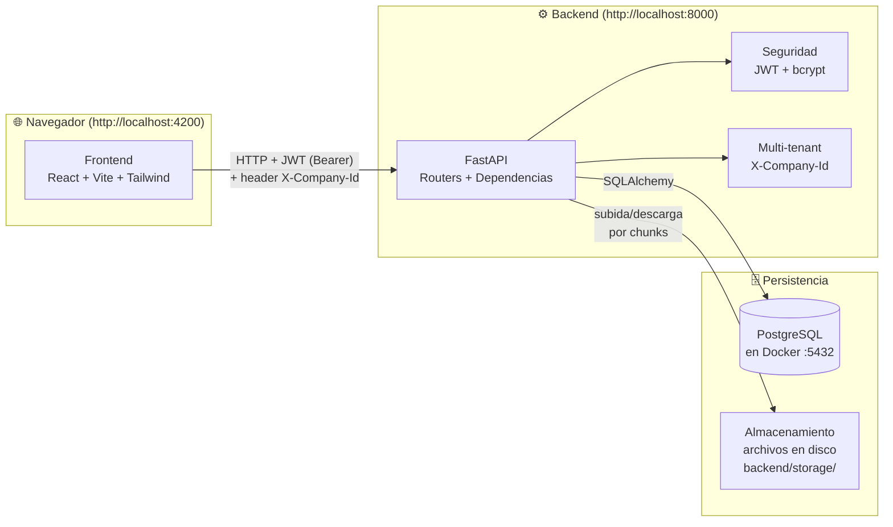
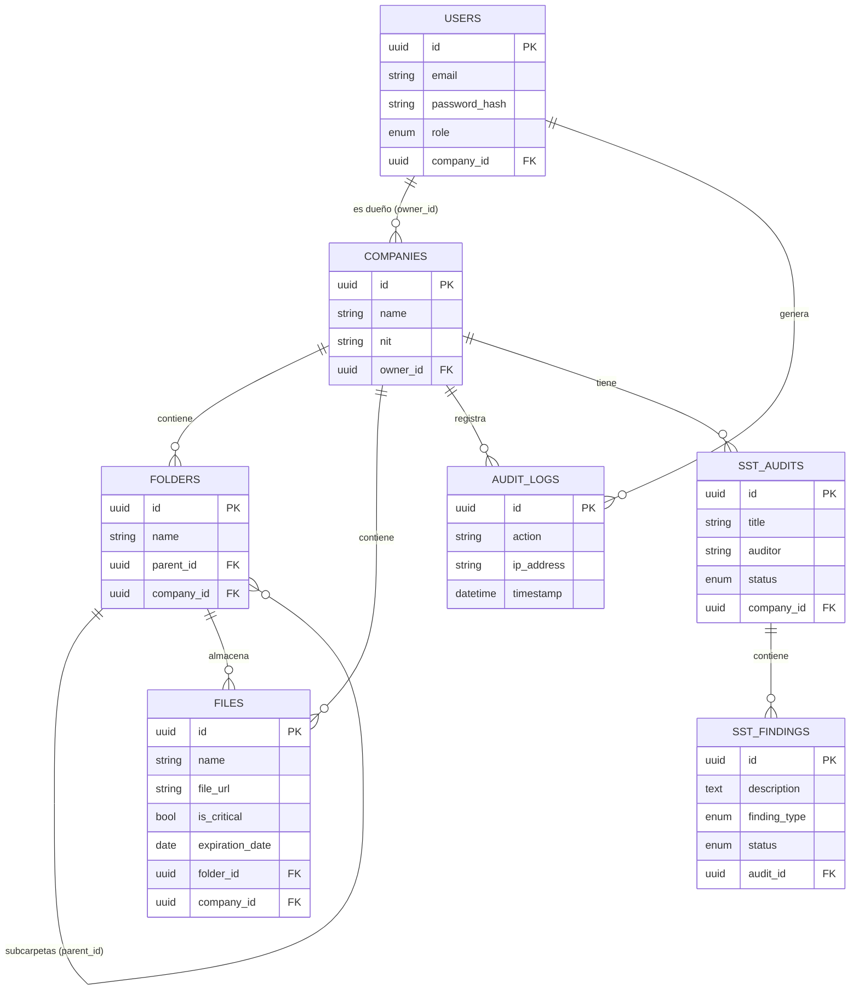
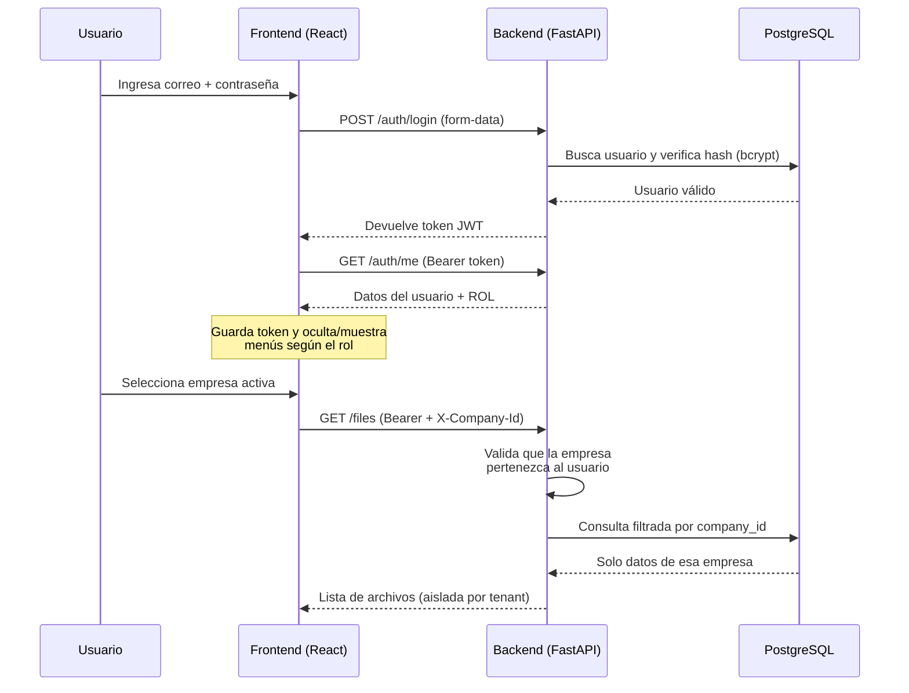
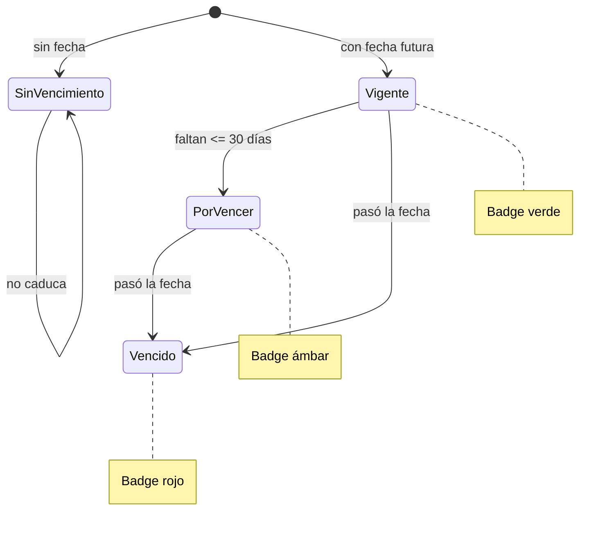

# 🏗️ Arquitectura del Sistema — SST SaaS

Documento visual de cómo encajan las piezas. Útil para explicar el proyecto en la presentación.

---

## Vista general (componentes y flujo)

---

## Modelo de datos (entidades y relaciones)

---

## Flujo de autenticación y multi-tenant

---

## Estados de un documento (control de vencimiento)

